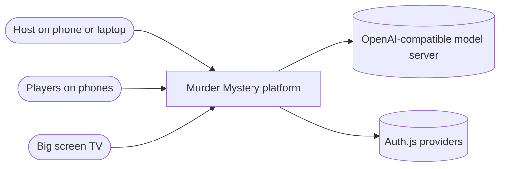
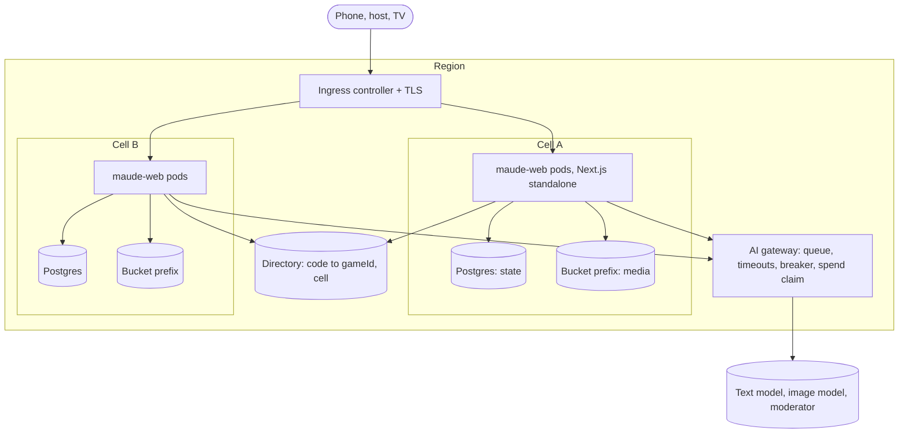
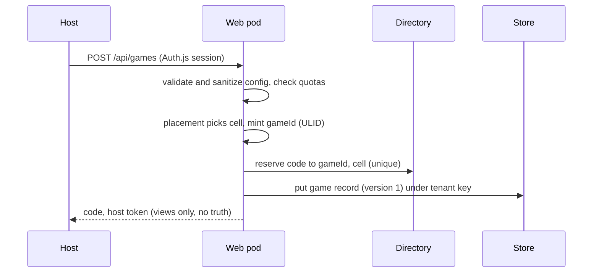
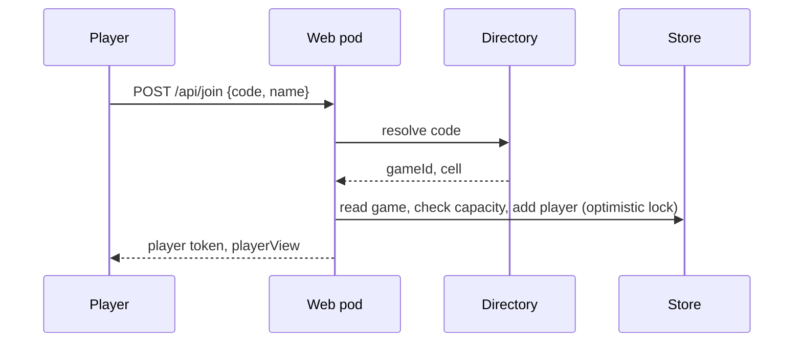
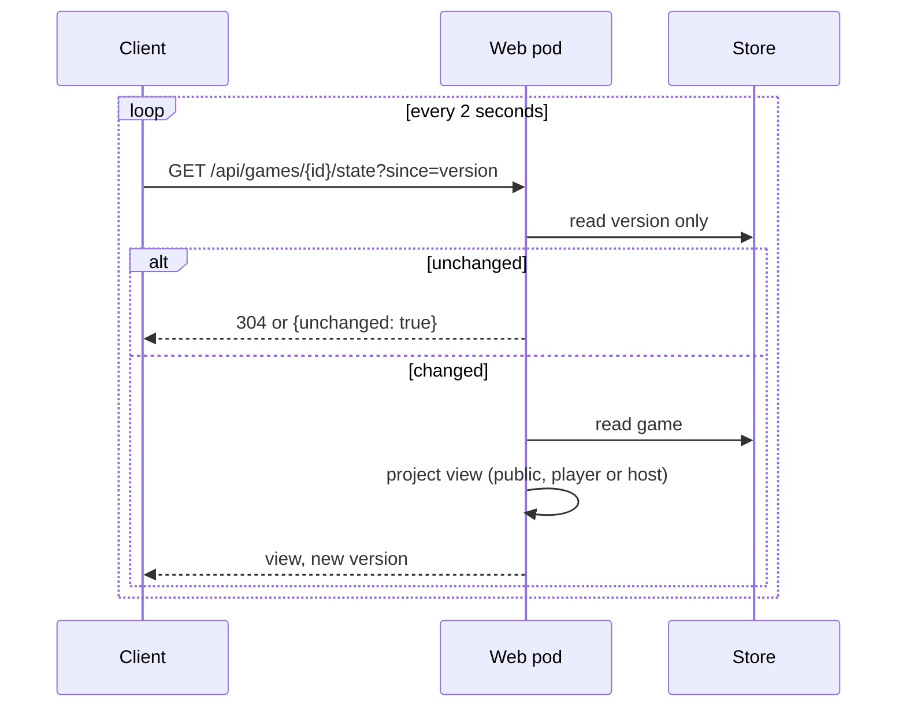
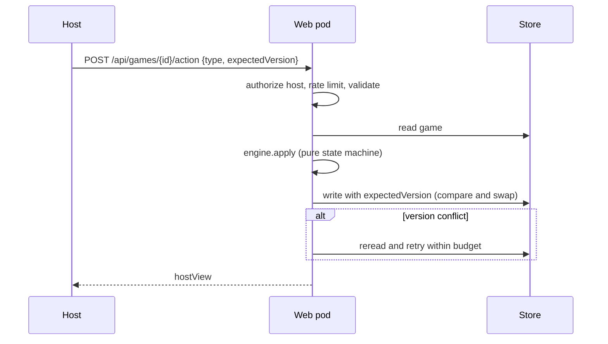
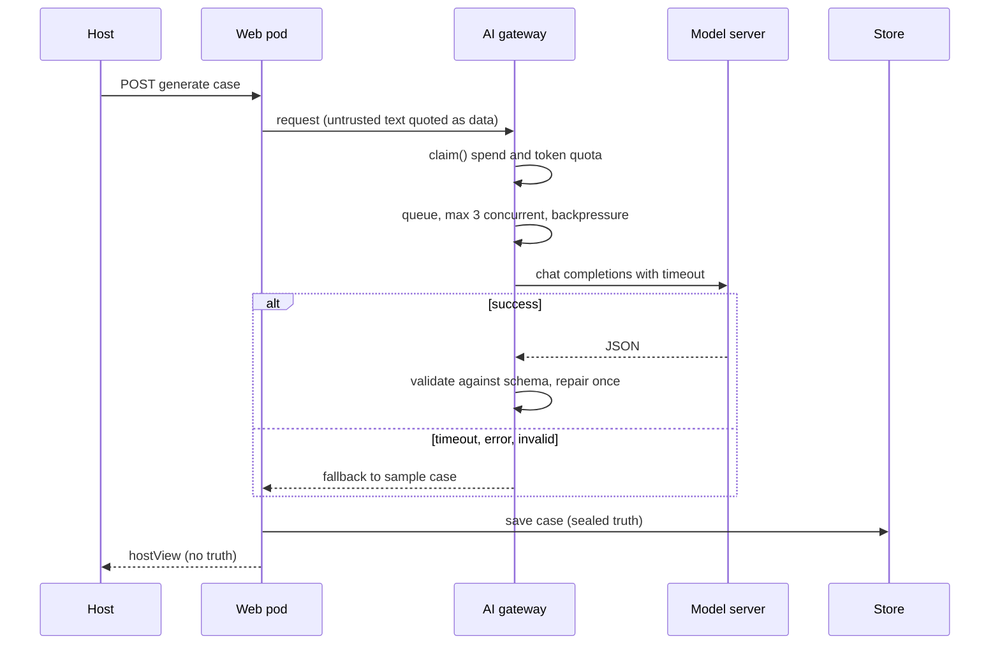

# Architecture

Status: design for this iteration. Binding constraints are in [CONTRACT.md](CONTRACT.md). Decisions are in [adr/README.md](adr/README.md). Terms are in [glossary.md](glossary.md).

## System context

## Containers

The AI gateway is code inside the web pods (W5), not a separate service in this iteration. It is drawn apart to show that every model call passes one choke point.

## Request flows

### Create game

If the code collides, the directory rejects it and the pod retries with a new code. The game record is written only after the code is reserved; a failed write releases the code.

### Join

A request that lands on a pod in the wrong cell is forwarded or redirected using the directory entry (see cell routing below).

### Poll state

The cheap path reads only the version. Views are always produced by `publicView`, `playerView` or `hostView`; a `Room` is never returned.

### Host action

Override code checks happen server side only, with lockout after 3 failures for 10 minutes.

### AI generation

Images and videos run as jobs in `media-jobs.ts`, one claimed at a time by `media-runner.ts`, each through `claim()`.

## Cell and region model

- A game lives in exactly one cell for its entire life. No migration in this iteration.
- A cell is: N web pods, one Postgres, one bucket prefix, one Helm release. Target 2,000 active games per cell.
- Every stored object is addressed `{cell}/games/{gameId}/{kind}/{name}` using the shared key builder (W3).
- The directory maps code to (`gameId`, cell, region). It is the only cross-game read. Lookups are O(1) by primary key.
- The directory is small (one row per live game) and replicated per region; entries are removed on delete or expiry.

### How a game is placed

1. Placement reads a cell registry: cell id, region, status (`open`, `draining`, `full`), capacity, current count.
2. Pick a region (closest to the host, from ingress geography; default is the local region).
3. Within the region pick an `open` cell with the lowest load (power of two choices on the active-game counter).
4. Increment the counter, mint `gameId`, reserve the code. If the cell is full, try another; if none, return 503 with retry advice.

### How a cell is added

1. Add an entry to the cell list in the OpenTofu root for that region (cell id, size class).
2. `tofu apply` (by a human) creates the Postgres, bucket prefix or bucket, IAM or workload identity, and a Helm release with `CELL_ID`.
3. Register it in the cell registry as `open`. New games start flowing to it. Existing games are untouched.
4. To retire a cell: mark `draining` (no new games), wait for TTL expiry (`GAME_TTL_HOURS`, default 24), then destroy.

### How a region is added

1. Add a region block to the OpenTofu root: cluster module (EKS, AKS, GKE, per [portability-matrix.md](portability-matrix.md)), directory replica, ingress, DNS record.
2. Add at least one cell in the region.
3. Add the region to the global DNS policy (latency or geo routing). Games are pinned to the region where they were created; see [ADR-0012](adr/ADR-0012-multi-region-strategy.md).

### Routing

The join code carries no region. A request that arrives at a region that does not own the game does a directory lookup and returns a redirect to the owning region host name (for example `eu.play.example.com`). Clients then stay on that host. For phones this is one extra hop at join time only.

## Data flow: state, blobs, AI

| Data | Path | Secret? | Notes |
|---|---|---|---|
| Game state (Room, case, truth) | Web pod to `Store` (Postgres in cloud, files locally) | Yes (truth) | Optimistic version per game. Never returned raw. |
| Views | Engine projections to clients | Filtered | Only `publicView`, `playerView`, `hostView`. |
| Photos | Client to pod to moderation to `MediaStore` | Yes | Consent first, moderated before storage, 1 day expiry, never served to others. |
| Generated art | Model to `MediaStore`, served via pod or signed URL | No | Public inside the game only. |
| Prompts and model output | Pod to AI gateway to model | Truth is sent to the model, not the Override Code | Untrusted text is quoted data. Output is schema validated. |
| Directory | Pod to directory | No | Code to gameId and cell only. |
| Logs and metrics | Pod stdout and `/metrics` | No secrets | Include `gameId`, `cell`, never views or truth. |

## Failure modes and degradation

| Failure | Behaviour | Secrets safe? |
|---|---|---|
| AI model down or slow | Timeout, retry budget, circuit breaker opens, case falls back to `sample-case.ts`, media to mock. Host sees a notice. Game continues. | Yes |
| AI returns invalid JSON | Repair once, otherwise fall back to sample case. | Yes |
| AI queue full | Backpressure: return "busy, retrying" and let the job wait. Game phases never block on AI. | Yes |
| Store slow | Per call timeout, bounded retries. Reads of version fail fast; clients keep showing the last state and retry quietly. Writes return 503 with `Retry-After`. | Yes |
| Store unavailable | `/readyz` fails, pod leaves the load balancer, ingress shows a friendly page. Other cells keep working. | Yes |
| Version conflict | Reread and retry within a small budget, then 409 to the client. | Yes |
| Blob store down | Photos and new art fail with a retryable error; text game continues. | Yes |
| Directory down | New joins fail with 503; existing players keep polling (their token carries the game id and cell). | Yes |
| Cell full | Placement skips it. If all cells in a region are full, create returns 503 and the next region is suggested. Existing games unaffected. | Yes |
| Pod crash | Stateless: the next poll hits another pod. No session affinity needed. | Yes |
| Noisy game | Per game rate limit and quota (W10) returns 429 for that game only. | Yes |

Principle: failures degrade the experience, never leak secrets. Blast radius is one cell.

## Intentionally NOT built yet

- Cell migration or rebalancing of live games.
- Server Sent Events or websockets (documented upgrade path, [ADR-0007](adr/ADR-0007-polling-vs-sse-vs-websockets.md)).
- A standalone AI gateway service; it is a library inside the web pods.
- Cross-region failover of a live game (a region loss loses that region's games; see ADR-0012).
- Azure Blob adapter (spec only), and cloud image or moderation adapters beyond the existing ones.
- Autoscaling policies tuned from real load (placeholders only until the `scale` project reports).
- Mobile app wrappers (Android, iOS): a TODO, the UI is kept portable.
- Billing, accounts for guests, and cross-game analytics.
- Applying any infrastructure: agents only validate and lint.
