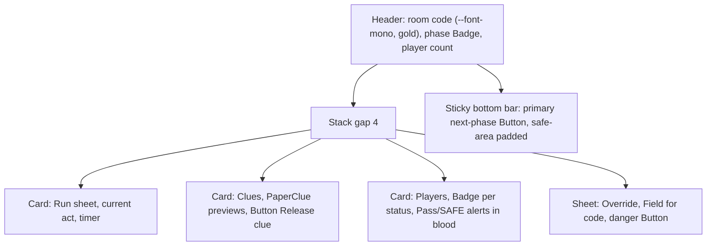

# Design system: the candle-lit study

Owner: W6. Code: `web/src/styles/`, `web/src/components/ui/`, `web/public/`.

## Concept

A noir study at midnight. The room is ink-dark; the only warmth is candle gold. Evidence arrives as torn paper clues, secrets are closed with wax seals, fog drifts at the edges, brass-gold marks what matters. It must stay a party game: playful, G-rated, never gory. Spooky means "cosy creepy", like a family board game, not horror.

Material vocabulary: **ink** (backgrounds, text), **wax seal** (confirmations, identity), **torn paper** (clues, readable content), **fog** (atmosphere), **brass / candle** (primary actions, focus of attention).

## Principles

1. Mobile first, designed at 360 px wide. One thumb, one primary action, bottom-reachable.
2. Contrast before mood. Atmosphere is added with light and texture, never by lowering text contrast.
3. Paper is for reading. Long text (clues, cards, narration) sits on paper or a raised card, not on fog.
4. Motion is seasoning. Every animation has a still equivalent; nothing essential is conveyed by motion alone.
5. Silent by default. No autoplay sound, ever.
6. Components hold no business logic and use no browser API except tiny wrappers (`Sheet` focus handling, `RegisterServiceWorker`).
7. Player-written text is data: render as plain text (React escaping), never as HTML.

## Tokens

Defined in `web/src/styles/tokens.css`. Dark only (`color-scheme: dark`).

| Token | Value | Use |
|---|---|---|
| `--bg` | #0e0b12 | page |
| `--bg-raised` | #1a1520 | cards, sheets |
| `--bg-sunken` | #08060b | inputs, badges |
| `--ink` | #f3ead8 | primary text |
| `--ink-dim` | #b9ad9c | secondary text |
| `--accent` | #e8b04a | candle gold: primary action, highlights |
| `--accent-ink` | #1a1204 | text on accent |
| `--blood` | #f2766f | danger text and borders |
| `--blood-deep` | #8c1d26 | wax, danger fills |
| `--ghost` | #8fd3e8 | links, focus ring, cool highlight |
| `--good`, `--warn` | #6fd6a0, #f0b04a | status |
| `--paper`, `--paper-ink`, `--paper-dim` | #efe3c8, #2a2018, #5c4b3a | evidence paper |
| `--border`, `--border-soft` | #76668a, #3a3045 | UI component edge (3:1), decorative edge |
| `--radius`, `--radius-sm` | 14px, 8px | shape |
| `--space-1..6` | 4, 8, 12, 16, 24, 40 px | spacing |
| `--font-display` | Iowan Old Style, Palatino, Georgia, serif | headings, clue titles |
| `--font-body` | system-ui stack | body |
| `--shadow-glow` | gold halo | secret cards, hover on primary |
| `--focus-ring` | 3px gap, 2px ghost ring | every `:focus-visible` |
| `--touch` | 44px | minimum target |
| `--dur-1..3`, `--ease` | 120, 240, 480 ms | motion |
| `--safe-*` | env(safe-area-inset-*) | notches |

Legacy aliases kept for old pages: `--fg`, `--muted`, `--card`, `--line`, `--accent-fg`, `--good`, `--warn`.

No external fonts and no font files are shipped: serif display fallbacks plus CSS flourishes (paper clip-path, wax gradients). A self-hosted face can be added later as an ADR.

### Type scale

`--text-xs` 13px, `-sm` 15px, `-md` 17px (body), `-lg` 22px, `-xl` 30px, `-2xl` 40px. On `[data-surface="tv"]` the scale becomes 24/32/44/64/96 px (readable at 3 m on 1920x1080; body never below 32 px).

## Motion

| Animation | Where | Reduced-motion variant |
|---|---|---|
| `mm-spin` | Button loading spinner | static ring at 60 percent opacity |
| `mm-fade`, `mm-sheet-up` | Sheet open | appears instantly |
| `mm-toast-in` | Toast | appears instantly |
| `mm-slide-in` | PaperClue `animateIn` | appears instantly |
| `mm-stamp` | WaxSeal `press` | final state |
| `mm-drift` | Fog | static fog |
| `mm-flicker` | Candle | steady flame |
| hover/press transitions | Button, WaxSeal | none |

Rule: any new `animation` must be added to the `@media (prefers-reduced-motion: reduce)` block in the same file; `check-contrast.mjs` fails the build otherwise.

## Iconography

Few, simple, filled glyphs with 2 px strokes where outlined: candle, key, magnifier, envelope, mask, wax seal, torn ticket. Always paired with text for actions. Decorative icons are `aria-hidden`. No emoji as the only carrier of meaning. App icon: `public/icon.svg` and `public/icon-maskable.svg` (candle over a wax seal).

## Illustration language

Flat ink silhouettes with one warm light source, paper-grain texture, fog gradients in cool grey-blue. Characters are cartoon, rounded, friendly (AI art prompts should say "storybook, soft, family friendly"). No blood, weapons shown in use, or realistic injury; the "crime" is a stolen cake, a toppled toast, a missing heirloom as the case dictates.

## Sound policy

None by default. No autoplay. Any future sound is opt-in per device, off after reload, with a visible mute control, and never required to play.

## Microcopy tone

Playful, a little theatrical, warm. Short sentences. Kids can read it.

- Do: "A clue slides under the door.", "Your secret is safe with us.", "That code is not in the ledger."
- Don't: gore ("you are dead"), shaming ("wrong!"), jargon ("Error 500"), alcohol pressure. "Pass" and "SAFE" are always visible options, never styled as failure.
- Errors say what happened and what to do next. Buttons are verbs: "Seal the accusation", "Join the party".

## Do and don't

- Do use `PaperClue` for any clue or evidence; `Card tone="secret"` for private role cards.
- Do keep one primary (`Button` gold) action per screen.
- Do respect safe areas; sheets and toasts already add bottom inset.
- Don't use `--blood` text on paper (use `#8c1d26`), or `--ink-dim` below 13 px.
- Don't hide information in hover only; don't rely on color alone (badges carry text).
- Don't add inline fixed pixel widths above 360 px; no horizontal scroll.

## Components (`web/src/components/ui`, import from `@/components/ui`)

`Button` (primary, secondary, ghost, danger; loading; block), `Card` (default, secret, glow), `PaperClue` (label, stamp, tilt, animateIn), `WaxSeal` (decorative, or a button when `onPress`), `Field` (wires id, label, hint, error, aria-invalid, aria-describedby onto one child control), `Sheet` (dialog, focus trap, Escape, bottom sheet under 768 px), `ToastProvider` + `useToast` (polite status, assertive for errors, auto dismiss), `Badge`, `Stack`, `Fog`, `Candle`, `Gallery` (all of the above, mount at `/dev/ui`), `RegisterServiceWorker`. Class prefix `mm-`; styles in `styles/ui.css`.

## Compat layer

`styles/base.css` styles the legacy classes (`.card`, `.card.secret`, `.row`, `.pill`, `.muted`, `.code`, `.err`, `.ok`, `.grid`, `.big`, `ul.clean`, `button`, `.btn`, `.ghost`, raw inputs and labels) in the new theme, and `tokens.css` keeps the old variable names as aliases. Existing pages restyle themselves without changes; W7 migrates to `ui/` components gradually and may delete the legacy block when done.

## PWA

`public/manifest.webmanifest` (standalone, dark theme color), SVG icons, `public/sw.js`: caches only `/_next/static/*`, icons and manifest, GET and same origin; never `/api`, HTML or anything with game state. Registered in production only. Layout sets `viewport-fit=cover`, theme color, manifest and apple-touch icon. Note: iOS prefers PNG touch icons; generating PNGs from the SVG is a TODO for the native wrapper work.

## Checks

```
cd web && node src/styles/check-contrast.mjs     # or: npx tsx src/styles/check-contrast.mjs
```

Verifies WCAG contrast for every text/background pair (4.5:1 text, 3:1 UI edges and focus ring), that every `animation` selector has a reduced-motion override, and that no `@keyframes` is unused. Exits non-zero on failure. Current result: all pairs pass (lowest: `border` on `bg-raised` 3.45:1).

## Screen compositions

### Phone (player), 360 px

```
+--------------------------------+
| (safe-area top)                |
| [Candle]  The Last Toast  [M]  |  header: display font, seal = my character
| ~~~~~~ Fog (decor) ~~~~~~~~~~~ |
| +----------------------------+ |
| | Card tone=secret           | |  private role: gold border + glow
| | You are: Aunt Marigold     | |
| | Secret text on raised bg   | |
| +----------------------------+ |
|   +------------------------+   |
|   | PaperClue  [NEW]       |   |  torn paper, slight tilt
|   | Exhibit B: torn ticket |   |
|   +------------------------+   |
|                                |
| [ Accuse a suspect ]  <- Button primary, block, 56px, thumb zone
| [Pass]  [SAFE]        <- ghost, always visible
| (safe-area bottom)  Toast here |
+--------------------------------+
```

### Host console (phone or laptop)



Laptop (>= 768 px): two columns, run sheet left, players right; Sheet becomes a centered dialog.

### Big screen (TV, 1920x1080, `data-surface="tv"`)

```
+----------------------------------------------------------------+
|  [Candle big]     THE LAST TOAST            Join: ABCX  [QR]   |  title 96px display
|                                                                |
|        +--------------------------------------------+          |
|        |  PaperClue (large, tilt -1deg)             |          |  body >= 32px
|        |  "Exhibit C: the missing locket"           |          |
|        +--------------------------------------------+          |
|  Badge row: players ready                                      |
|  ~~~~~~~~~~~~~~~~~ Fog opacity .3 ~~~~~~~~~~~~~~~~~~~~~~~~~~~~ |
+----------------------------------------------------------------+
```
No interactive controls, no timers under 32 px, no motion-only cues; the reveal uses a WaxSeal `press` plus text.
