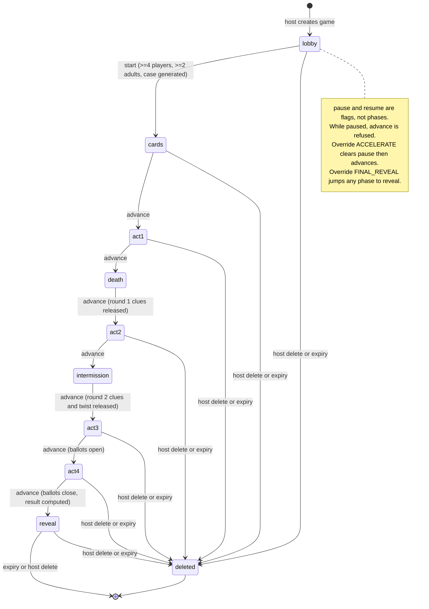

# Domain specification

Status: target spec (W2). "Today" notes describe `web/src/lib/*` as read on 2026-10-20. Binding companion: `../CONTRACT.md`.

## 1. Entities

| Entity | Meaning | Today (types.ts) | Target |
|---|---|---|---|
| Game (a.k.a. Room) | One party session. Aggregate root: everything below lives inside it. | `Room`, keyed by `code` | `Room` plus `gameId` (ULID). Stored under the tenant key. |
| Host | The signed-in adult who runs the game. Exactly one per game. | `room.hostId` (Auth.js subject) | Same. Owns delete, export, override code. |
| Player | A guest in the game. Authenticated by `id` + `token`, no account. | `Player` | Same. Adds no PII beyond name, age group, optional backstory. |
| Character | A fictional role in the case. Assigned to a player at start. | `Character` in `CaseFile.characters` | Same. Cards are private to the assigned player. |
| Clue | Evidence released in rounds 1 and 2, plus the twist (id `twist`). | `Clue`, `releasedClueIds` | Same. |
| Ballot | A player's accusation: killer, method, motive. One per player, replaceable while open. | `Player.ballot` | Same. |
| MediaItem | One generated image or video job and its result. Raw photos are not MediaItems. | `MediaItem` | Same. Keyed `{cell}/games/{gameId}/media/{id}`. |
| Budget | Spend cap, spent, reserved, media plan. Local models count at zero but are recorded. | `BudgetState` | Adds token counters (see section 6). |
| Directory entry | Join code to `gameId` and cell. The only cross-game record. | none (code is the key) | `{code, gameId, cell, expiresAt}`; O(1) lookup. |
| Result | Computed once at reveal: scores, awards, truth. | `Result` | Same. Never exists before reveal. |

Value types: `Phase`, `AgeGroup` (`little` (toddlers and preschoolers), `kid`, `teen`, `adult`), `Spice`, `GameConfig`, `MediaPlan`, `PlayerProfile`, `CaseFile`.

### Secret classification

| Class | Fields | Who may ever receive it |
|---|---|---|
| Truth | `case.killerId`, `case.victimId` (before cast is public), `case.truth.*`, `case.nudges`, `case.advanced`, other players' `card`, `characterId` of others, `result` | Nobody before the Reveal. After Reveal: everyone gets the reveal block. Host gets nudge/advanced/final text only through the override code. |
| Credential | `Player.token`, `overrideSalt`, `overrideHash`, `failedOverrides`, host session | Token: its owner only (returned once at join). Override fields: never leave the server. |
| Private to player | own `card`, own `backstory`, own `ballot`, own photo | The owning player. Host sees `hasPhoto`, backstory mode, ballot submitted yes/no, never the card text or ballot content. |
| Never in any view | `photoKey`, `media.key`, `media.lockUntil`, `jobRef`, tenant key prefixes, `gameId` | Server only. |

## 2. Identifiers

| Id | Shape | Visible to users | Purpose |
|---|---|---|---|
| `gameId` | 26 char Crockford ULID, e.g. `01J9Z3Q8K4V7N2M5X6B1C0D9EF` | No. Never in a URL, view, log line shown to users or QR. | Tenant key, storage addressing, audit. Time sortable, not guessable enough to be a credential. |
| join `code` | 4 to 6 chars from `ABCDEFGHJKMNPQRSTUVWXYZ` (no I, L, O, digits), case-insensitive on input, stored upper case | Yes (QR, TV, host console) | Human entry. Resolves to `gameId` via the directory. Not a secret: knowing it allows joining a lobby only. |
| `playerId` | 6 random bytes base64url (8 chars) | Yes, to host and own player | Addressing within a game. |
| player `token` | 18 random bytes base64url (24 chars) | Owner only | Bearer secret for a player. Compare in constant time (target). |
| `mediaId` | random base64url | Yes (via `media` list) | Addressing generated art within a game. |

Rules:
1. A code is unique among live games in a region. The directory write is conditional (`put if absent`). Collision retries up to 20 times, then fails with 503 (today 500).
2. A code is held for `CODE_QUARANTINE_MINUTES` (target 60) after delete or expiry so a stale QR cannot land in someone else's game.
3. Code length starts at 4 (about 280k combinations with 23 letters, 23^4 = 279,841). When live games in a region exceed 10 percent of the space, the issuer moves to 5, then 6. Existing codes are unaffected.
4. Today the code is the storage key; target: `gameId` is the key and the code is directory-only. Any API path keeps accepting `{code}` (the directory resolves it), so no client change is needed.

## 3. Lifecycle state machine

Phases come from `types.ts` (`PHASES`). Transitions are forward only; there is no way back.



Transition table:

| From | Trigger | Guard | Effects |
|---|---|---|---|
| lobby | `start` (host) | 4+ players, 2+ adults | Generate case (AI or sample), cast players, queue avatars, go to `cards`. |
| any non-lobby, non-reveal | `advance` (host) or override ACCELERATE | not paused | Next phase. `act2` releases round 1 clues. `act3` releases round 2 clues and `twist`. Entering `act4` opens ballots; leaving closes them. Entering `reveal` computes `result`. Media jobs queue for the new phase. |
| any non-lobby | override FINAL_REVEAL (confirmed) | override code valid, not locked | Jump to `reveal`. |
| any | `pause`/`resume` (host) | host only | Flag only. |
| any | delete (host) / expiry | host session, or `now > expiresAt` | Section 8. |

Lobby-only operations: join, host `addPlayer` (no device), photo upload is allowed in `lobby` and `cards`. `kick` today works in any phase (see "What changes").

## 4. Invariants

Each invariant has an owner test project: U unit, C contract, S security, B BDD.

### Secrecy (S, B)
- I-S1 No response body, header, log line or error message contains truth fields before `phase === "reveal"` (except host via valid override).
- I-S2 `playerView` contains exactly one `character` card: the caller's.
- I-S3 `publicView` contains no card text, no `characterId`, no `killerId`, no `truth`. It may contain character names, house, tease, kid flag (public roster, by design).
- I-S4 `hostView` never contains `case`, cards, ballot contents, `token`, `overrideHash`, `overrideSalt`, `photoKey`.
- I-S5 The solution reaches the host only via override NUDGE, ADVANCED or FINAL with a valid code, and sets `overrideUsed`.
- I-S6 Sample case and AI case are held to the same rule; the model prompt never contains the override code.
- I-S7 Errors for another game's resources are indistinguishable from "not found" (404), never 403 with detail.

### Budget (U, C)
- I-B1 `spentUsd + reservedUsd <= capUsd` at all times. A job whose estimate would break this is `skipped`.
- I-B2 Every paid or local generation passes through `claim()`. Local models record cost 0 and token counts, still pass through `claim()`.
- I-B3 `capUsd` cannot be lowered below `spentUsd + reservedUsd`.
- I-B4 Reservations are released on failure and on skip. `paused` stops new claims immediately.
- I-B5 `fitPlan` keeps estimate under `cap * (1 - 0.15)` at creation.

### Override code (S, B)
- I-O1 Stored only as salted scrypt; minimum 4 characters at creation.
- I-O2 Comparison is constant time on equal-length digests.
- I-O3 3 consecutive failures lock overrides for 10 minutes (`lockedUntil`); the failure counter resets on lock and on success. The lock applies even if the correct code is then supplied.
- I-O4 Failure counts and the lock persist (written even though the action errors). A retry storm across pods cannot bypass it (conditional write).
- I-O5 FINAL and FINAL_REVEAL need `confirm: true` the second time.
- I-O6 The code is never logged, echoed, stored in plain text, or sent to a model.

### Age-group rules (U, B)
- I-A1 `little` and `kid` players never take part in alcohol mechanics; drinking content is addressed to adults only and `drinking: "none"` removes it entirely.
- I-A2 Kids' content is G-rated. Kid characters are never killer, never selectable as a suspect (`suspectList` excludes `kid`).
- I-A3 The victim is chosen from kid/teen volunteers first (non-scary ghost role), adult fallback. A `little` is never the victim (target; today `young` includes only kid and teen, so true).
- I-A4 Photo consent: adults `self`, anyone under 18 `guardian` (today any non-adult). Teens count as under 18.
- I-A5 "Pass" always skips a prompt for that player; "SAFE" always pauses the activity. Both are table rules, enforced in generated content and UI copy (never gated by a button the host can disable).

### Other
- I-G1 Phase order is monotonic. `ballotsOpen` is true only in `act4`.
- I-G2 One ballot per player; replaceable while open; options must exist in the case; killer must be an assigned, non-victim, non-kid character.
- I-G3 Player names are unique per game (case-insensitive), 1 to 24 chars, trimmed, control characters stripped.
- I-G4 Max players per game 40 (becomes a quota, section 7). Game start needs 4 players and 2 adults.
- I-G5 Optimistic concurrency: every write carries the expected `version`; `version` increases by exactly 1 per successful write; a client with an equal `?v=` gets `{unchanged:true}`.
- I-G6 Untrusted text (backstory, host prompts, model output) is data: clamped, stored, rendered as plain text, passed to models as quoted JSON.

## 5. Tenant key scheme

```
{cell}/games/{gameId}/state/room.json           (file/S3 layouts; postgres uses a games row)
{cell}/games/{gameId}/media/{mediaId}          generated art and clips
{cell}/games/{gameId}/photos/{playerId}.jpg    raw consented photos
{cell}/games/{gameId}/export/{ts}.zip          host export (short lived)
{cell}/directory/{CODE}                         directory entry (only non-game key; the only cross-game read)
```

- One shared key builder (W3) produces all keys. Raw string concatenation of keys is a defect.
- `cell` = `CELL_ID`; `gameId` must match `^[0-9A-HJKMNP-TV-Z]{26}$` before use in a key (prevents traversal and prefix confusion).
- Deleting a game = delete prefix `{cell}/games/{gameId}/` plus the directory entry. Today the equivalent prefix is `{code}/photos` and media keys are not prefix-isolated (see "What changes").
- Lists and scans are always within one prefix and paginated.

## 6. Retention and deletion

| Data | Default retention | Deleted when |
|---|---|---|
| Game state | `GAME_TTL_HOURS` (24) from creation; target also hard max 72 hours | Expiry sweep per cell (bounded, paginated), host delete |
| Raw photos | 1 day or game end, whichever is first; purged at the `reveal` phase transition (target; today only on manual purge and S3 lifecycle) | Player removal, host `purgePhotos`, game delete, expiry |
| Generated media | Game lifetime | Game delete, expiry |
| Directory entry | Game lifetime plus quarantine | Game delete, expiry |
| Export bundle | 1 hour | Expiry sweep |
| Logs | No truth, tokens, codes or photo content; 30 days | Log retention policy (W10) |

Export (host only): a zip of the host's own game: config, roster with names and age groups, public clue list, result after reveal, media files. Never raw photos, tokens, override data or (before reveal) any truth. Export is audit-logged without contents.

Deletion is idempotent and leaves no readable remnant: after delete, every endpoint for that game returns 404, including media URLs.

## 7. Quotas (per game; defaults from W10's config module)

| Quota | Default | On exceed |
|---|---|---|
| Players | 40 | 409 `GAME_FULL` |
| Requests per client per minute | 120 state polls (30 per minute steady), 30 per minute for mutating calls | 429 + `Retry-After` |
| Requests per game per minute | 3,000 | 429 |
| Stored bytes (photos + media + state) | 200 MB | 413 `QUOTA_STORAGE` |
| AI spend | `budget.capUsd` | job `skipped`, note explains |
| AI tokens | 200,000 in+out per game | job `skipped`, sample fallback |
| Games per host per day | 10 | 429 `QUOTA_HOST_GAMES` |

## 8. What changes versus today

| Area | Today | Target |
|---|---|---|
| Identity | `code` is the storage key (`pk = code`) | `gameId` ULID key; `code` via directory |
| Store | memory or DynamoDB, one JSON item | `Store` port: memory, file, postgres; `get(gameId)`, `put`, `delete`, directory ops |
| Whole-game write | Whole `Room` rewritten on each action | Same for now; version check preserved |
| State poll auth | `?v=` unchanged short-circuit happens BEFORE auth, so any caller can learn a game's version number | Authenticate first, then compare version (W7/W10) |
| `role` param | Caller picks `screen`, `host`, `player` | Same, but screen view gets its own allowlist and is rate limited per IP |
| Delete game | none (TTL only) | `DELETE /api/rooms/{code}` host only, plus export |
| Photo purge | manual, or S3 lifecycle | also automatic at `reveal` and at expiry |
| Media route | `/media/{id}` is public for anyone with code and id | Same visibility (art is public by design) but scoped to the game's prefix, 404 across games |
| Kick | allowed any phase, leaves orphaned character | Lobby only (target); after start use pause |
| Player cap | hard-coded 40 | quota config |
| Rate limits | none | headers + 429 (W10 middleware) |
| Errors | `{error: string}` | `{error:{code,message,requestId}}` (see API spec; old shape tolerated by clients during migration) |
| Health | none | `/api/healthz`, `/api/readyz` |
| Token compare | `!==` string compare | constant time |
| Budget | USD only | USD plus tokens, local model cost 0 |
| TTL | fixed `createdAt + 24h` | same, optionally extended by host once up to the hard max |
| Code space | 4 letters fixed | grows by load (rule 3 in section 2) |
